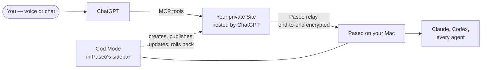

# Paseo God Mode

### Talk to ChatGPT. Every Paseo agent obeys.

Full voice and chat control of [Paseo](https://paseo.sh) from ChatGPT. Start agents in any
project, hear what they did, approve, steer and stop them — from your phone, your car or a
walk, while your Mac does the work.

🎙️ **Voice or chat** · 🧠 **Every agent, every project** · 🪄 **Guided setup in the sidebar, no terminal** · 🔐 **Encrypted end to end to your Mac** · ⬆️ **Update by tap or by voice**

---

## What it feels like

> **You:** What are my agents doing right now?
>
> **ChatGPT:** Three are working. The one in *api* is waiting for your approval to run a migration.
>
> **You:** Approve it. Then start a chat in *web-app* and fix the flaky login test.
>
> **You:** And update God Mode to the latest release.

## How it works

- ChatGPT talks to a small MCP server that runs as a **private ChatGPT Site in your own account**. Only you can call it.
- The Site reaches your Mac through **Paseo's relay, encrypted end to end** with your daemon's key. God Mode opens no ports on your Mac.
- **The plugin lives in Paseo's sidebar.** It creates that Site for you, publishes it, keeps it on the latest release and puts the previous one back if a release goes wrong.

## Install

1. In Paseo open **Settings → Plugins**, turn plugins on, paste `github:devXpro/paseo-god-mode-plugin` into **Plugin source** and press **Install**.
2. Open **God Mode** in the sidebar.

## Setup — the sidebar walks you through it

1. **Check** — Paseo, the Codex CLI and the relay, each found or fixed for you.
2. **Sign in to ChatGPT** — open a link, enter a code. Works from your phone too.
3. **Your Site** — create a new private Site, or reuse one you already have.
4. **Preferences** — language, the model for new chats, what needs your confirmation.
5. **Connect this Mac** — the plugin hands your Site the key to this Paseo, stored as a Site secret.
6. **Publish** — watch it build, publish and check itself.
7. **Turn it on in ChatGPT** — one link, then ask ChatGPT anything about your agents.

## What you can do from ChatGPT

- See what every agent is doing, across all projects.
- Find a chat by its name, its project or something said in it.
- Hear the last turn, several turns at once, or the commands an agent ran.
- Start a new chat in any project, with the model and mode you want.
- Send a follow-up, or steer or interrupt a busy agent.
- Approve or deny what an agent asks for.
- Stop an agent.
- Check which version of God Mode is live, update it or roll it back.

## Updates and rollback

- **Update to latest** — one tap in the sidebar, or say *"update God Mode"* to ChatGPT.
- Every release is tested, published and then checked against the live plugin. If the check fails, the previous version goes back by itself.
- **Roll back** to any earlier release, by tap or by voice.

## Requirements

- A Mac running [Paseo](https://paseo.sh) 0.11 or newer — and the Paseo app on your phone, if you want God Mode there too.
- **ChatGPT Plus or Pro**: the plans that include ChatGPT Sites.
- The Codex CLI. The copy inside the ChatGPT desktop app works.
- Your Mac awake and online while you use it.

## Privacy and security

- Your Site is private to your ChatGPT account; everyone else is turned away before your code runs.
- The key that lets the Site reach Paseo is a full key to your Paseo daemon. It lives only as a secret of your Site, which Sites never returns in plain text — never in this repository, never on screen.
- Your ChatGPT sign-in stays with the Codex CLI on your Mac. The plugin keeps no passwords or tokens of its own.
- Approvals, stops, updates and rollbacks are confirmed before they happen.
- When your Mac is asleep or offline, ChatGPT tells you so and changes nothing.

## Status

**Building in public.** The ChatGPT side already drives Paseo end to end, voice on an iPhone
included. The sidebar plugin, its guided setup and one-tap updates are being built now —
watch the repository for the first release.

## Licence

[MIT](LICENSE). ChatGPT is a trademark of OpenAI; this project is not affiliated with or
endorsed by OpenAI.
