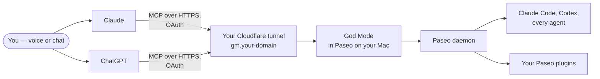

<div align="center">


# Paseo God Mode

### Talk to Claude or ChatGPT. Every Paseo agent obeys.

Full voice and chat control of [Paseo](https://paseo.sh) from Claude and ChatGPT. Start agents in any
project, hear what they did, approve, steer and stop them, and use your other Paseo plugins — from
your phone, your car or a walk, while your Mac does the work.

[](https://github.com/devXpro/paseo-god-mode-plugin/releases)
[](https://paseo.sh)
[](https://claude.ai)
[](https://chatgpt.com)
[](LICENSE)
[](#status)

🎙️ **Voice or chat, in Claude or ChatGPT** · 🧠 **Every agent, every project** · 🧩 **Your Paseo plugins too** · 🔘 **Three buttons, no terminal** · 🔐 **Your own tunnel and sign-in** · ⚡ **Straight to Paseo on your Mac or Windows**

</div>

---

## What it feels like

> **You:** What are my agents doing right now?
>
> **Claude:** Three are working. The one in *api* is waiting for your approval to run a migration.
>
> **You:** Approve it. Then start a chat in *web-app* and fix the flaky login test.

The same works in ChatGPT, typed or in its voice mode.

## Quick start

You need:
- a Mac running **Paseo 0.15.4** or newer, awake and online while you use God Mode;
- a domain in your own **Cloudflare** account (the free plan is enough): God Mode puts its address
  there, for example `gm.example.com`;
- **Claude** (custom connectors; voice mode in the phone app), **ChatGPT** Plus or Pro (custom MCP
  servers on chatgpt.com), or both;
- Node.js with npm, which Paseo uses to install God Mode from GitHub. Homebrew is optional: with it
  God Mode installs `cloudflared` through `brew`, without it from Cloudflare's own release.

1. **Install.** In Paseo open **Settings → Plugins**, turn plugins on, paste
   `github:devXpro/paseo-god-mode-plugin` into **Plugin source** and press **Install**. Or pin a
   release from a terminal: `paseo plugin add github:devXpro/paseo-god-mode-plugin --ref vX.Y.Z`.
2. **Open God Mode in the sidebar.** It has three buttons:
   1. **Address → Connect.** Cloudflare opens: sign in, pick your domain, press **Authorize**. God Mode
      creates `gm.<your domain>` and keeps the tunnel running.
   2. **Claude → Connect.** Claude opens on its connectors and the address is copied: **Add custom
      connector**, name it God Mode, paste the address, **Add**, **Connect**, then enter the code God
      Mode shows.
   3. **ChatGPT → Connect.** chatgpt.com/plugins opens and the address is copied: **Add → Add custom
      MCP server**, name it God Mode, paste the address as the **Server URL**, choose **OAuth**,
      **Create**, then enter the code.
3. **Ask.** *"What are my agents doing?"* — by voice or in a chat.

`main` is where development happens; releases are the tags.

## How it works



- **God Mode is the MCP server.** It runs inside Paseo on your Mac and answers Claude and ChatGPT at one
  address.
- **Your Cloudflare tunnel gives it that address.** `cloudflared` dials out to Cloudflare; no port is
  opened on your Mac or your router.
- **Claude and ChatGPT sign in.** Each registers itself with God Mode and you sign it in once with a
  short code from God Mode's screen. You can disconnect either from the same screen.
- **Paseo is reached directly**, on the same Mac, with the daemon's local credential: nothing about
  Paseo leaves the Mac except the answers you ask for.

More: [architecture](docs/architecture.md).

## What you can do

From Claude or ChatGPT, by voice or in a chat:

- **Watch your agents** — what every agent and its helpers are doing, in every project.
- **Catch up on a chat** — find it by name, project or something said in it; hear what it said, ran
  or reasoned, and see its screenshots.
- **Put agents to work** — start a chat in any project, on the model and effort you name, send a
  follow-up, steer or interrupt one.
- **Decide for them** — approve or deny what an agent asks for, answer its questions, stop or archive
  a chat.
- **Run their slash commands** — `/compact`, `/code-review`, your own commands, in Claude Code and
  Codex chats; anything risky is read back to you first, and what cannot run says why.
- **Drive your other Paseo plugins** — anything beyond a harmless change is read back to you first.

Every tool, with its arguments and rules: [docs/tools.md](docs/tools.md).

## Security

- **The key to Paseo never leaves your Mac.** God Mode talks to the daemon locally; Claude and ChatGPT
  get tokens that only work through God Mode and that you can revoke from its screen.
- **Only Claude and ChatGPT can register**, only with their own callback addresses, and only you can
  sign them in: the code on God Mode's screen works once, for five minutes and five tries.
- **Tokens are kept on the Mac as hashes.** An access token lasts an hour; a refresh token is spent on
  use, and one that comes back signs that connection out.
- **Cloudflare carries the traffic** and decrypts it at its edge, as every Cloudflare proxy does;
  Anthropic and OpenAI see what you ask their assistant to read, as with any connector.
- **Writes happen only on your command.** Approvals, stops and archiving are read back to you first,
  and plugin actions above low risk run only with a confirmation bound to their exact arguments.
- **When your Mac is asleep or offline**, nothing answers and nothing changes.

What each part protects, and what it does not: [security](docs/security.md).

## Updates

Update God Mode in Paseo (**Settings → Plugins**). The gateway and the tunnel restart with it, and
Claude and ChatGPT stay connected. When an update changes the tools, start a new chat in Claude or
ChatGPT: both keep a chat's tool list. More: [operations](docs/operations.md).

## Documentation

| | |
| --- | --- |
| [Architecture](docs/architecture.md) | The parts, and how a sign-in, a tool call and a plugin action flow. |
| [Setup](docs/configuration.md) | The address, connecting Claude and ChatGPT, and what God Mode keeps on the Mac. |
| [Tools](docs/tools.md) | What Claude and ChatGPT can call. |
| [Slash commands](docs/slash-commands.md) | What runs for Claude Code and Codex, and what does not. |
| [Voice button](docs/voice-button.md) | An optional button in Paseo that opens ChatGPT voice on a Mac or iPhone. |
| [Plugin tools](docs/plugin-tools.md) | `plugin_read` and `plugin_action` in detail. |
| [Plugin contract](docs/plugin-capabilities.md) | `meta.describe` and `paseo.capabilities/1`, with `outcome`, `target`, `untrusted`. |
| [Writing a plugin](docs/plugin-authoring.md) | Implementing and testing `meta.describe`. |
| [Security](docs/security.md) | Trust model, sign-in, confirmations, errors. |
| [Operations](docs/operations.md) | Updates, logs, troubleshooting. |
| [Development](docs/development.md) | Layout, checks, testing on a separate Paseo, releases. |

## Development

```sh
npm ci
npm run check            # typecheck and tests: the plugin, its gateway and the MCP core
paseo plugin add "$PWD"  # run it from this checkout
```

The probe, the eval, a separate Paseo for testing and releasing: [development](docs/development.md).

## Versions

One version, `MAJOR.MINOR.PATCH`, covers the plugin, its gateway and the MCP core; each release is a
tag `vX.Y.Z` with notes in [CHANGELOG.md](CHANGELOG.md). 1.0 moved God Mode from a ChatGPT Site to
your Mac and added Claude. Within a major version, tools are only added, never removed or renamed.

## Status

Building in public: used every day on one Mac, by voice on an iPhone in Claude and ChatGPT. Expect
rough edges elsewhere and say so in the issues.

## Licence

[MIT](LICENSE). Claude is a trademark of Anthropic and ChatGPT a trademark of OpenAI; this project is
not affiliated with or endorsed by either.
