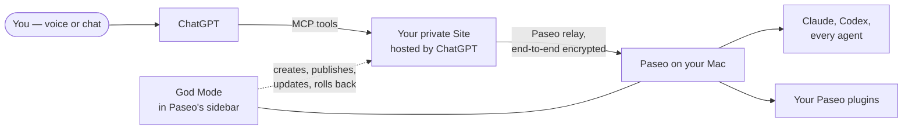

<div align="center">


# Paseo God Mode

### Talk to ChatGPT. Every Paseo agent obeys.

Full voice and chat control of [Paseo](https://paseo.sh) from ChatGPT. Start agents in any
project, hear what they did, approve, steer and stop them, and use your other Paseo plugins — from
your phone, your car or a walk, while your Mac does the work.

[](https://github.com/devXpro/paseo-god-mode-plugin/releases)
[](https://paseo.sh)
[](https://chatgpt.com)
[](LICENSE)
[](#status)

🎙️ **Voice or chat** · 🧠 **Every agent, every project** · 🧩 **Your Paseo plugins too** · 🪄 **Guided setup in the sidebar, no terminal** · 🔐 **Encrypted end to end to your Mac** · ⬆️ **Update by tap or by voice**

</div>

---

## What it feels like

> **You:** What are my agents doing right now?
>
> **ChatGPT:** Three are working. The one in *api* is waiting for your approval to run a migration.
>
> **You:** Approve it. Then start a chat in *web-app* and fix the flaky login test.
>
> **You:** And update God Mode to the latest release.

## Quick start

You need a Mac running Paseo 0.11 or newer with its relay on, ChatGPT Plus or Pro (the plans with
ChatGPT Sites), the Codex CLI (the copy inside the ChatGPT desktop app works), Node.js 22.13 or newer
and Git: the Site is built and tested on your Mac before it is published. The Mac has to be awake and
online while you use God Mode.

1. **Install.** In Paseo open **Settings → Plugins**, turn plugins on, paste
   `github:devXpro/paseo-god-mode-plugin` into **Plugin source** and press **Install**. Or pin a
   release from a terminal: `paseo plugin add github:devXpro/paseo-god-mode-plugin --ref vX.Y.Z`.
2. **Open God Mode in the sidebar** and go through its five sections:
   1. **This Mac** — checks Paseo's relay, the Codex CLI, your ChatGPT plan, Node.js and Git; sign in
      to ChatGPT with a link and a code, on the Mac or your phone.
   2. **Your Site** — create a new private ChatGPT Site, or use one you have.
   3. **Preferences** — language, the model, thinking and mode for new chats, how long to wait for a
      reply, read-backs, the call log.
   4. **Publish and update** — publish the Site and hand it the link to this Mac; later update it,
      apply settings or roll back.
   5. **Use it in ChatGPT** — open a new chat or start voice and ask *"What are my agents doing?"* If
      ChatGPT does not know the tools yet, connect your Site under **Plugins → Created by you**.

`main` is where development happens; releases are the tags.

## How it works



- ChatGPT calls a small MCP server that runs as a **private ChatGPT Site in your own account**.
- The Site reaches your Mac through **Paseo's relay, encrypted end to end** with your daemon's key.
  God Mode opens no ports on your Mac.
- **The plugin in Paseo's sidebar** creates that Site, publishes it, keeps it on the latest release and
  puts the previous one back if a release goes wrong.

More: [architecture](docs/architecture.md).

## What you can do from ChatGPT

- **Watch your agents** — what every agent and its helpers are doing, in every project.
- **Catch up on a chat** — find it by name, project or something said in it; hear what it said, ran
  or reasoned, and see its screenshots.
- **Put agents to work** — start a chat in any project, send a follow-up, steer or interrupt one.
- **Decide for them** — approve or deny what an agent asks for, stop or archive a chat.
- **Run their slash commands** — `/compact`, `/code-review`, your own commands, in Claude Code and
  Codex chats; anything risky is read back to you first, and what cannot run says why.
- **Drive your other Paseo plugins** — anything beyond a harmless change is read back to you first.
- **Keep God Mode current** — see which version is live, update it or roll it back.

Every tool ChatGPT gets, with its arguments and rules: [docs/tools.md](docs/tools.md).

## Configuration

Preferences are set in sidebar section 3 and reach your Site with the next release, or right away
with **Apply settings**: the language ChatGPT speaks, defaults for new chats, how long to wait for a
reply, whether approvals, stops and updates are read back first, and the call log. The link to your
Paseo is written by the plugin as a Site secret. Every setting: [configuration](docs/configuration.md).

## Security

- Your Site is private to your ChatGPT account. The key that lets it reach Paseo is a full key to your
  Paseo daemon; it lives only as a secret of your Site — never in this repository, never on screen,
  never in the call log.
- Your ChatGPT sign-in stays with the Codex CLI on your Mac; the plugin keeps no passwords or tokens of
  its own.
- Writes happen only on your command. By default, approvals, stops, archiving and updates are read
  back to you first. Plugin actions above low risk run only with a confirmation bound to their exact
  arguments.
- When your Mac is asleep or offline, ChatGPT says so and changes nothing.

What each confirmation proves, and what it does not: [security](docs/security.md).

## Updates and rollback

**Update** in the sidebar, or say *"update God Mode"* to ChatGPT: it publishes the version of the plugin
installed in Paseo, checks the live plugin and puts the previous version back by itself if the check
fails. When a newer release is on GitHub, God Mode says so: update the plugin in Paseo first. **Roll
back** to the release before the newest, by tap or by voice. After an update that adds tools, ChatGPT
can take minutes to show them: open a new chat. More: [operations](docs/operations.md).

## Documentation

| | |
| --- | --- |
| [Architecture](docs/architecture.md) | The parts and how one call, one plugin action and one release flow. |
| [Configuration](docs/configuration.md) | Every setting and what Paseo and ChatGPT need. |
| [Tools](docs/tools.md) | What ChatGPT can call. |
| [Slash commands](docs/slash-commands.md) | What runs for Claude Code and Codex, and what does not. |
| [Voice button](docs/voice-button.md) | An optional button in Paseo that opens ChatGPT voice on a Mac or iPhone. |
| [Plugin tools](docs/plugin-tools.md) | `plugin_read` and `plugin_action` in detail. |
| [Plugin contract](docs/plugin-capabilities.md) | `meta.describe` and `paseo.capabilities/1`, with `outcome`, `target`, `untrusted`. |
| [Writing a plugin](docs/plugin-authoring.md) | Implementing and testing `meta.describe`. |
| [Security](docs/security.md) | Trust model, confirmations, errors. |
| [Operations](docs/operations.md) | Updates, release jobs, troubleshooting. |
| [Development](docs/development.md) | Setup, checks, compatibility, releases. |

## Development

```sh
npm ci && npm --prefix gpt-site ci
npm run check            # typecheck and tests of the plugin and the Site
paseo plugin add "$PWD"  # run it from this checkout
```

Releasing, the probe and the compatibility rules: [development](docs/development.md).

## Versions

One version, `MAJOR.MINOR.PATCH`, covers the plugin and the Site it publishes; each release is a tag
`vX.Y.Z` with notes in [CHANGELOG.md](CHANGELOG.md). Within a major version, tools are only added,
never removed or renamed.

## Status

Building in public: used every day on one Mac, voice on an iPhone included. Expect rough edges
elsewhere and say so in the issues.

## Licence

[MIT](LICENSE). ChatGPT is a trademark of OpenAI; this project is not affiliated with or endorsed by
OpenAI.
