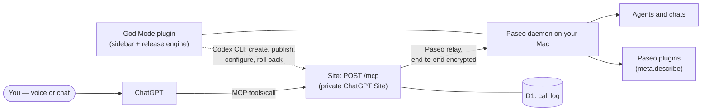
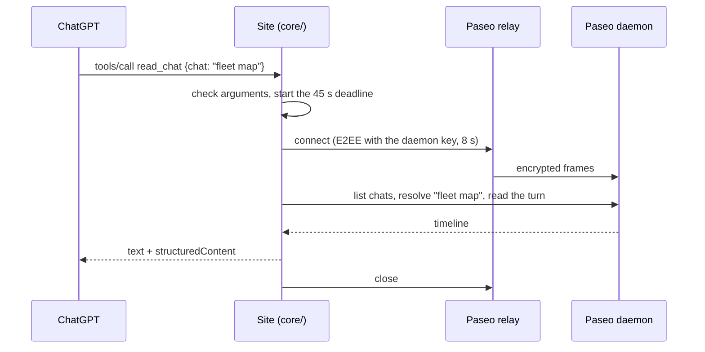
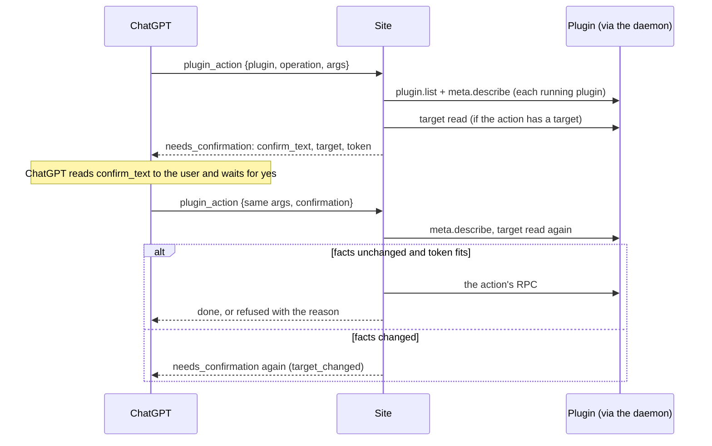
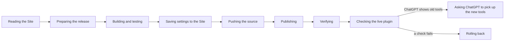

# Architecture

God Mode has two halves: a **Site**, an MCP server that runs as a private ChatGPT Site and that
ChatGPT calls, and a **Paseo plugin** in your sidebar that sets the Site up, publishes it and keeps
it updated. They meet only through your Paseo daemon. The reasoning behind most choices is in
[gpt-site/DESIGN.md](../gpt-site/DESIGN.md).



## Components

| Part | Where | What it does |
| --- | --- | --- |
| MCP endpoint | `gpt-site/app/mcp/route.ts` | Stateless JSON-RPC over `POST /mcp`; reads the Site's variables, marks whether a signed-in ChatGPT user is calling, and hands the message to `core/`. |
| Tools and rules | `gpt-site/core/mcp.mjs` | Settings, server instructions, tool metadata, dispatch, deadlines, logging hooks. |
| Paseo operations | `gpt-site/core/paseo.mjs` | One relay connection per call; chats, turns, activity, images, writes, slash commands, plugins, release status. |
| Plugin contract | `gpt-site/core/capabilities.mjs` | Checks `meta.describe` answers, resolves names, checks arguments, trims answers, signs confirmations. |
| Slash commands | `gpt-site/core/slash.mjs` | The provider adapters: which of a chat's commands run, at what risk and how; arguments; what a run did. |
| Text | `gpt-site/core/text.mjs` | Name matching and the short text ChatGPT reads or speaks. |
| Images widget | `gpt-site/core/widget.mjs` | The MCP Apps widget `show_images` uses. |
| Call log | `gpt-site/db/` | D1 table `call_log`, read by `get_logs`. |
| Sidebar | `client/` | The setup and update screens in Paseo. |
| Plugin server | `index.server.ts`, `server/` | Environment checks, ChatGPT sign-in through the Codex app-server, Sites list/create/connect, preferences, the release engine and its ledger. |
| Shared contracts | `shared/` | The RPC contracts between the sidebar, the plugin server and the Site. |

## One tool call



- The Site keeps no connection between requests: every call connects, works and closes. Measured
  through the relay, a read takes about 1 to 1.3 seconds; writes that wait for the agent take up to
  the configured wait (at most 25 seconds).
- A tool call has 45 seconds in all; ChatGPT gives up on tool calls at about a minute.
- Without the pairing link, every tool but `get_logs` refuses.

## A plugin action that asks first



Details: [plugin-tools.md](plugin-tools.md); guarantees: [security.md](security.md).

## A release

The plugin's release engine runs on the Mac, started from the sidebar or by `update_site`:



It publishes the Site source shipped with the installed plugin, builds and tests it on the Mac,
publishes through the Codex CLI and then calls the live plugin the way ChatGPT does. See
[operations.md](operations.md).

## Where the model's guidance lives

| Layer | Content |
| --- | --- |
| Server instructions | The domain, which tool for which request (in the first 512 characters), the write rules, the language, dictation hints. |
| Tool and argument descriptions, annotations | "Use this when…", what each argument takes, read or write. |
| Lines in results | The next step: ask which chat, still working, nothing was sent. |
| Plugin descriptions | Each plugin's own titles, descriptions and `confirmText`, through `plugin_read` and `plugin_action`. |

The text for the model is English; `PASEO_LANGUAGE` sets the language ChatGPT speaks.

## Repository layout

```text
index.server.ts, index.client.tsx   the Paseo plugin's entry points
server/                             plugin server: environment, sign-in, Sites, preferences, release engine
client/                             sidebar screens
shared/                             contracts and the product version
gpt-site/                           the Site (published as its own package)
  core/                             everything that matters, runs under Node and node --test
  app/mcp/route.ts                  wires core/ into the Worker
  db/, drizzle/                     the call log and its migration
  eval/                             the tool-selection eval
docs/                               this documentation
```

The Site's source must stay self-contained: Sites packages `gpt-site/` only.
